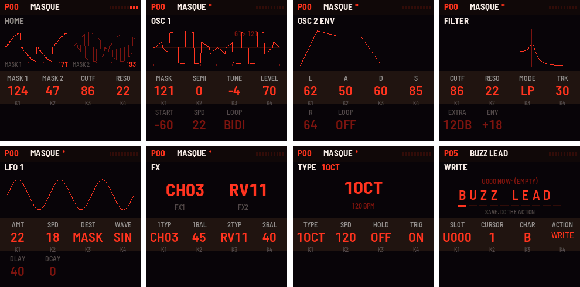
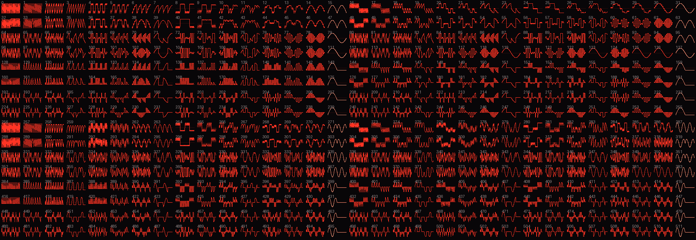

# MASQUE

A bitmask synthesizer for the M-VAVE FM-1, after Kodamo's MASK1: two bitmask oscillators a voice, a sample-and-hold
noise, a resonant state-variable filter, four loopable envelopes, mask and pitch delta envelopes, two LFOs, the
MASK1's nine play modes with slur detection, an arpeggiator, a looper and two effects. Ten voices (up to twelve),
forty factory sounds, 128 of your own.

Built on [fm1-base](https://github.com/charlesvestal/fm1-base) (felucca-bsp underneath, MPL-2.0, no closed code),
as [KIST](https://github.com/78Hz/kist) is.

MASQUE is an independent project. It is not made, endorsed or supported by Kodamo; MASK1 is Kodamo's. No Kodamo code,
sounds or data are in it: the oscillator was rebuilt from what Kodamo and the MASK1's manual say it does (below).

## Bitmask synthesis

What Kodamo has published: *a sine wave is split into sections that are repeated, scaled, inverted or silenced, to
build a new waveform, all from one number you enter*; the number is 9 bits (512 waveforms an oscillator); low numbers
give simple waves, high ones bleepy, raspy, formant-like ones; between two masks lie sub-masks (the mask value's least
significant bits), which the mask envelope passes through. The manual names a few masks: 31 is the sine, 7 a pure saw,
8 a square whose low half is made of small saws, 20..25 square-like, 56 a pulse, 78 a buzz at the sine's pitch, 28..30
bell-like, and every mask of the form 16k - 1 (15, 31, 47, 63, 79, 95 ...) is rounded and mellow. How the bits map to
those operations has never been published.

MASQUE's oscillator is one reading of that, which every one of those named masks comes out of:

- The oscillator reads a sine with a 32-bit phase. The phase's top five bits are the cycle's 32 **sections**.
- Mask bits 0..4, **KEEP**: an AND over those five phase bits. A cleared bit makes the sections repeat: 31 keeps all
  (the sine), 15 drops the top one (the first half twice: rounded), 7 the top two (a quarter four times: a saw), 8
  keeps a single middle bit (a square whose low half is small saws, as the manual draws it).
- Bit 5, **FLIP**: the sections read backwards where the highest dropped bit of the phase is set.
- Bit 6, **INVERT**: the sections upside down where the dropped bits have odd parity (78: a buzz at the sine's pitch).
- Bit 7, **SILENCE**: the sections silenced where the lowest dropped bit is set (gaps: pulses).
- Bit 8, **REPEAT**: each kept piece holds three turns of the sine (formants).
- With nothing dropped, the operations act on the two halves of the cycle, so every 16k - 1 stays rounded.
- Three **sub-masks** between each pair: the position's two fraction bits clear phase bits 25 and 26, below the
  sections, so the pieces grow fine steps. The mask envelope, the LFOs, velocity and aftertouch move through them.
- Each mask's DC is taken out and its level evened (`dsp/mask_table.h`, made from the oscillator by
  `tools/gen_masks.c`). The oscillators run at four times the rate and come down through two halfbands: the sharp
  edges alias far less, as the MASK1's oversampled oscillators do.

All 512, as MASQUE draws them (the 16k - 1 masks lighter):

The code is `dsp/bitmask.h`: everything is worked out per section when the mask changes, so a sample costs an AND, an
XOR, a multiply and a table read.

## Playing it

The MASK1 edits a section at a time with a Value knob; the FM-1 has four knobs under the screen, so each page shows
its values in rows of four (K1..K4) and SELECT walks the rows. **The player's manual is [docs/MANUAL.md](docs/MANUAL.md).**

| Control | What |
|---|---|
| HOME | the sound: both masks drawn as they move; K1 MASK 1, K2 MASK 2, K3 CUTF, K4 RESO |
| SEL | OSC 1 → OSC 2 → NOISE → FILTER |
| ENV | the envelope of the section shown (L A D S R LOOP), as the MASK1's Env button |
| LFO | LFO 1 ↔ LFO 2 |
| EDIT | PITCH → MOD → GENERAL |
| FX, ARP, SEQ, GLO | the effects, the arpeggiator (ARP on its page: HOLD), the looper, the part's settings |
| REC, PLAY | the looper: REC waits for the first note and records; REC or PLAY again plays it; PLAY stops |
| SAVE | the WRITE page; SAVE again does its K4: WRITE (into a user slot), INIT, REVERT, SETUP (for power-on) |
| SELECT | every row of every page in turn |
| ALGORITHM | the one number: the MASK of the oscillator shown (OSC 1 elsewhere) |
| PRESETS | the sounds: P00..P39, then U000..U127; it loads when the knob rests |
| OCT- / OCT+ | the FM-1's keys; both: back to 0 |
| MASTER | volume |

The FM-1's keys play with velocity, and their pressure is each voice's aftertouch (poly). MIDI comes in over USB
and the TRS jack: notes, velocity, poly and channel aftertouch, pitch bend, the mod wheel (CC 1), sustain (CC 64),
all notes off, program changes and MIDI clock (the arpeggiator follows it). The FM-1's own keys go out over USB.

## Building

    git clone --recursive https://github.com/78Hz/masque
    python3 fm1-base/tools/build.py . --host        # the simulator: build/host/masque_host
    build/host/masque_host tests/host/basic.txt build/host     # the scripted test, with screenshots

    tools/build_tools.sh                            # the engine's own tools and tests (cc)
    build/engine_test                               # every sound rendered into build/wav/, the play modes, the looper
    build/gen_masks > dsp/mask_table.h              # after any change to the oscillator (dsp/bitmask.h)

    JIELI_TOOLCHAIN=... AC79_SDK=... python3 fm1-base/tools/build.py .   # the firmware: build/masque.fwsc

The toolchain and SDK: `fm1-base/tools/get_toolchain.sh`, or the mirrors of
[setup-fm1-toolchain](https://github.com/DimmKirr/setup-fm1-toolchain)'s releases.

## Installing

Download `masque-X.Y.fwsc` from the [latest release](https://github.com/78Hz/masque/releases/latest) (or the
`firmware` artifact of the latest Build run), then either:

- **FM-1 Manager** (the same release, for macOS, Windows and Linux): open it, add the file under Firmware and press
  *Install on FM-1*. It also takes backups and puts M-VAVE's firmware back. See [manager/](manager/).
- **The command line**: `python3 fm1-base/tools/fm1_install.py masque-X.Y.fwsc`
  (`pip install mido python-rtmidi` first).

Connect the FM-1 straight to the computer with a USB data cable, switched on as normal. Before the first install,
take a whole-flash backup (FM-1 Manager → Whole flash) while M-VAVE's firmware is still on it.

Writing a sound, or the setup, writes the flash, which stops everything for a moment, the sound too. Your sounds and
the setup can be backed up and restored over USB (FM-1 Manager → Saved data).

To go back: install M-VAVE's `FM-1.fwsc` the same way (or with M-VAVE's M-UPGRADE). An FM-1 that won't start shows
SAFE MODE after two tries, where USB still works; failing that, FM-1 Manager → Whole flash → *Put M-VAVE firmware
back*.

## Releases

A tag `vX.Y`, or running the Build workflow by hand with a version, builds everything on GitHub
(`.github/workflows/build.yml`): the release firmware (`masque-X.Y.fwsc`, identity FM-1_61XXYY00, and
`firmware.json`), the tests, and FM-1 Manager for each platform. Every push to main builds and tests the firmware.

## What is not the MASK1's

- One part. The MASK1's multitimbral parts, layers and splits are not here.
- The FM-1 has no wheels: pitch bend and the mod wheel come over MIDI. Its keys' pressure is aftertouch.
- The factory sounds are MASQUE's own (forty of them), not Kodamo's.
- The effects are the MASK1's families and numbering (CH, DT, BC, RM; DL, RV, DT), each sixteen of MASQUE's own;
  the reverbs are KIST-P's plate (Dattorro's) in sixteen sizes.
- The looper keeps 4096 events (the MASK1 10000).
- No MIDI CC map beyond CC 1, 64, 120 and 123.

## Not yet known

- **The cost on the device.** The oscillators are about 33 instructions a sample each at four times the rate (counted
  in the firmware's code); a voice about 340 instructions a sample in all, so ten voices are roughly 150 million a
  second, shared by the two cores when the second runs. The render times itself every block and lets a voice go when
  it runs long; the GLOBAL page shows the load and the voices allowed. Play ten notes on the device with a reverb on
  and read it.
- **The sound on the FM-1's own speaker and outputs**: heard so far only as renders on a computer.
- The factory sounds are a first pass, set from renders and spectra; they want ears.

## Licence

MASQUE is under the [Mozilla Public License 2.0](LICENSE), as fm1-base and felucca-bsp. FX2's plate is KIST-P's
(`dsp/plate.c`, MPL-2.0). The screen's fonts are fm1-base's (Barlow, SIL Open Font License 1.1).
